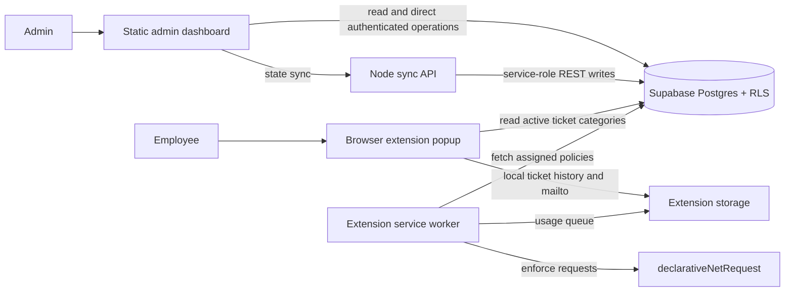

# Managed Site Guard

Managed Site Guard is a browser-based website policy and device support system. The admin dashboard manages devices, blocking rules, schedules, ticket settings, analytics, and update logs. A Chrome/Edge Manifest V3 extension applies blocking rules on managed browsers and provides employees with device details and a ticket form.

## Architecture



### Components

- **`dashboard/`** — Static HTML, CSS, and JavaScript for admin workflows and local fallback storage. `app.js` maps dashboard fields to Supabase columns, hydrates records, and manages settings and update logs.
- **`extension/`** — Manifest V3 extension. `background.js` refreshes and enforces blocking policies; `popup.html` and `popup.js` show endpoint information and collect employee issue reports; `options.html` configures Supabase and device details.
- **`backend/`** — Node.js API that batches dashboard state writes using a server-only Supabase service-role key.
- **`supabase/`** — Idempotent database schema, row-level security policies, and seed scripts.
- **`docs/`** — Setup, deployment, and administrator guidance.

The dashboard Update Log opens from the current-version badge. Release notes are shipped with the dashboard version, and dashboard state retains the latest 20 entries.

### Data flow and storage

1. An administrator changes dashboard settings, devices, schedules, policies, or ticket behavior.
2. The dashboard saves a local copy and sends supported state to Supabase directly or through `/api/supabase-sync`.
3. Supabase stores records in tables such as `employees`, `devices`, `policies`, `schedules`, `usage`, `ticket_settings`, `tickets`, and `changelog`. RLS policies govern client access.
4. The extension refreshes its assigned blocking policies and applies matching rules in the browser. The issue form reads active categories from the limited `ticket_category_settings` snapshot.
5. Extension issue reports and conversations currently use extension-local storage and a `mailto:` handoff; they are **not** submitted into the shared Supabase `tickets` table.

## Requirements

- Chrome or Edge 120 or newer
- A Supabase project
- Node.js for the optional secure sync API and repository tests
- Python or another static web server for local dashboard development

## Setup

### Supabase

In the Supabase SQL editor, run these scripts in order:

1. [`supabase/schema.sql`](./supabase/schema.sql)
2. [`supabase/employee-role-migration.sql`](./supabase/employee-role-migration.sql) to normalize employee names and role categories
3. [`supabase/rls.sql`](./supabase/rls.sql)
4. [`supabase/admin-seed.sql`](./supabase/admin-seed.sql) to insert/update the default administrator

The seed creates a custom dashboard account (`admin@sys13.com`, initial password `admin123`) in `employees`, `user_credentials`, and `admin_access_assignments`. It does not create a Supabase Auth user. Change the initial password before production use. The seed must be run manually; this repository cannot apply it to a live project.

The Incognito blocker publishes its single enabled/disabled value through the read-only `incognito_control` table. Configure the protected secure sync backend for dashboard writes, and enable **Allow in Incognito** for the extension in the managed browser.

See [`docs/supabase-setup.md`](./docs/supabase-setup.md) for RLS, extension host access, and deployment notes.

### Dashboard and backend

Serve the workspace root with a local static web server, then open `/dashboard/`. Configure the dashboard with a Supabase URL and publishable/anon key, or configure the secure sync API endpoint.

For server-side state sync, set these environment variables for the backend process:

```text
SUPABASE_URL=https://your-project.supabase.co
SUPABASE_SERVICE_ROLE_KEY=server_only_service_role_key
PORT=3000
```

Install dependencies with `npm install`, then start the API with `npm run start:backend`. Keep the service-role key on the server only. The sync endpoint must be protected by an authenticated reverse proxy or private network before public deployment; the dashboard's custom browser login does not authenticate API requests.

### Browser extension

1. Open `chrome://extensions` or `edge://extensions` and enable Developer mode.
2. Load the `extension/` directory as an unpacked extension.
3. Open its settings and enter the Supabase URL, anon key, device ID, and enrollment details.
4. Approve the requested Supabase host permission. This is used to retrieve the public active-category snapshot.

## Behavior and limitations

- The extension uses `declarativeNetRequest` for browser-side blocking; browser/OS management may be needed for stronger enforcement and Incognito restrictions.
- Analytics and usage depend on enrolled devices and policies being configured and connected.
- Popup-created tickets are local to the browser and handed to the configured email client. They are not yet synchronized to the admin ticket table.
- Admin database writes require a configured Supabase project and valid permissions. Local browser storage is used as a fallback and does not synchronize by itself.

## Development and validation

Run the configured checks from the workspace root:

```text
npm run test:security
node tests/dashboard-data-mapping.test.js
npm run validate:supabase
```

The test files cover default-admin bootstrap assumptions, backend sync payloads, employee permissions, and dashboard field mappings.

## Current versions

- Admin dashboard: **1.5.1**
- Browser extension: **1.5.1**
