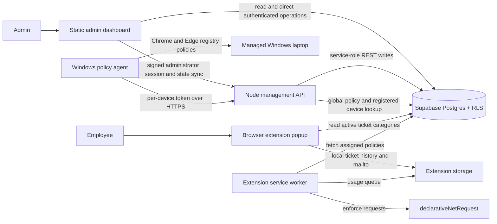

# Managed Site Guard

Managed Site Guard is a browser-based website policy and device support system. The admin dashboard manages devices, blocking rules, schedules, ticket settings, analytics, and update logs. A Chrome/Edge Manifest V3 extension applies blocking rules on managed browsers and provides employees with device details and a ticket form.

## Architecture



### Components

- **`dashboard/`** — Static HTML, CSS, and JavaScript for admin workflows and local fallback storage. `app.js` maps dashboard fields to Supabase columns, hydrates records, and manages settings and update logs.
- **`extension/`** — Manifest V3 extension. `background.js` refreshes and enforces blocking policies; `popup.html` and `popup.js` show endpoint information and collect employee issue reports; `options.html` configures Supabase and device details.
- **`backend/`** — Node.js API using the installed `@supabase/supabase-js` client with a server-only service-role key. `backend/supabase.js` owns the shared client; backend files use CommonJS imports to match the existing project module format.
- **`windows-agent/`** — Elevated startup agent that polls the global policy, applies and verifies Chrome/Edge registry values, and restores prior values when disabled.
- **`supabase/migrations/`** — Database migrations for centralized policy state and protected per-device agent credentials.
- **`docs/`** — Setup, deployment, and administrator guidance.

The dashboard Update Log opens from the current-version badge. Release notes are shipped with the dashboard version, and dashboard state retains the latest 20 entries.

### Data flow and storage

1. An administrator changes dashboard settings, devices, schedules, policies, or ticket behavior.
2. The dashboard saves a local copy and sends supported state to Supabase directly or through `/api/supabase-sync`.
3. Supabase stores records in tables such as `employees`, `devices`, `policies`, `schedules`, `usage`, `ticket_settings`, `tickets`, and `changelog`. RLS policies govern client access.
4. The global Incognito setting is stored as `system_policies.policy_name = 'incognito_blocking'`. Authenticated admin endpoints and RLS protect writes; each provisioned Windows agent fetches the same row and applies it to its registered laptop.
5. The extension refreshes its assigned website-blocking policies and applies matching rules in the browser. The issue form reads active categories from the limited `ticket_category_settings` snapshot.
6. Extension issue reports and conversations currently use extension-local storage and a `mailto:` handoff; they are **not** submitted into the shared Supabase `tickets` table.

## Requirements

- Chrome or Edge 120 or newer
- A Supabase project
- Node.js for the secure management API, agent provisioning, and repository tests
- Windows laptops for registry-based Incognito enforcement
- Python or another static web server for local dashboard development

## Setup

### Supabase

The legacy MINDLOCK schema is managed outside this repository. On the existing project, confirm its `devices`, `incognito_control`, `employees`, and `user_credentials` tables are present, then run [`supabase/migrations/20261104172000_incognito_blocking.sql`](./supabase/migrations/20261104172000_incognito_blocking.sql). Keep using the organization's existing administrator provisioning process.

The existing Incognito blocker keeps its compatibility value in `incognito_control`; the authoritative global setting is `system_policies.incognito_blocking`. The management API updates both in one database function. The Windows agent—not the browser extension—enforces the Chrome and Edge operating-system policies.

See [`docs/supabase-setup.md`](./docs/supabase-setup.md) for RLS, extension host access, and deployment notes.

### Dashboard and backend

Serve the workspace root with a local static web server, then open `/dashboard/`. Configure the dashboard with a Supabase URL and publishable/anon key, or configure the secure sync API endpoint.

For server-side state sync, set these environment variables for the backend process:

```text
SUPABASE_URL=https://your-project.supabase.co
SUPABASE_SERVICE_ROLE_KEY=server_only_service_role_key
ADMIN_SESSION_SECRET=a_random_secret_at_least_32_characters
ALLOWED_ORIGINS=http://localhost:8000,http://127.0.0.1:8000
PORT=3000
```

Generate a signing secret with `node -e "console.log(require('node:crypto').randomBytes(48).toString('base64url'))"`. Set `ALLOWED_ORIGINS` to the exact dashboard origins; install dependencies with `npm install`, then start the API with `npm run start:backend`. Keep both secrets server-side. The API validates the administrator password and role against Supabase, issues a short-lived signed session, and rechecks the administrator role for protected operations. Deploy the API behind HTTPS and a rate-limiting reverse proxy; never expose the service-role key.

### Windows management agent

For each registered and assigned laptop, provision one per-device token on the backend host with `node backend/provision-agent.js <device-row-id>`. Deliver the one-time token to the target laptop through an approved secure channel. From an elevated PowerShell session in `windows-agent/`, run `.\Install-Mindlock-PolicyAgent.ps1 -ApiBaseUrl https://your-management-api.example -DeviceId <device-row-id>` and enter the token at the secure prompt. The installer stores it in an ACL-protected ProgramData file and creates a SYSTEM startup task.

The agent polls the same global policy on boot and every 60 seconds by default. When enabled it applies and verifies Chrome `IncognitoModeAvailability=1` and Edge `InPrivateModeAvailability=1`. When disabled it restores the prior values only if those values are still the ones MINDLOCK applied; unrelated policy values are left unchanged. Newly registered laptops inherit the policy as soon as their agent is provisioned and connects.

### Browser extension

1. Open `chrome://extensions` or `edge://extensions` and enable Developer mode.
2. Load the `extension/` directory as an unpacked extension.
3. Open its settings and enter the Supabase URL, anon key, device ID, and enrollment details.
4. Approve the requested Supabase host permission. This is used to retrieve the public active-category snapshot.

## Behavior and limitations

- The extension uses `declarativeNetRequest` for scheduled website blocking. Incognito/ InPrivate enforcement is performed by the privileged Windows agent and requires the laptop to be managed and connected to the backend.
- Analytics and usage depend on enrolled devices and policies being configured and connected.
- Popup-created tickets are local to the browser and handed to the configured email client. They are not yet synchronized to the admin ticket table.
- Admin database writes require a configured Supabase project and valid permissions. Local browser storage is used as a fallback and does not synchronize by itself.

## Development and validation

Run the Incognito policy tests from the workspace root:

```text
npm run test:incognito
```

The test covers admin session validation, centralized policy updates and device coverage, per-device agent credentials, and the single dashboard toggle.

## Current versions

- Admin dashboard: **1.5.1**
- Browser extension: **1.5.1**
